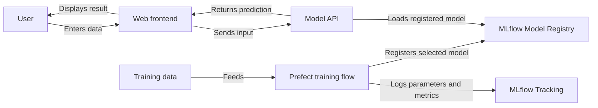
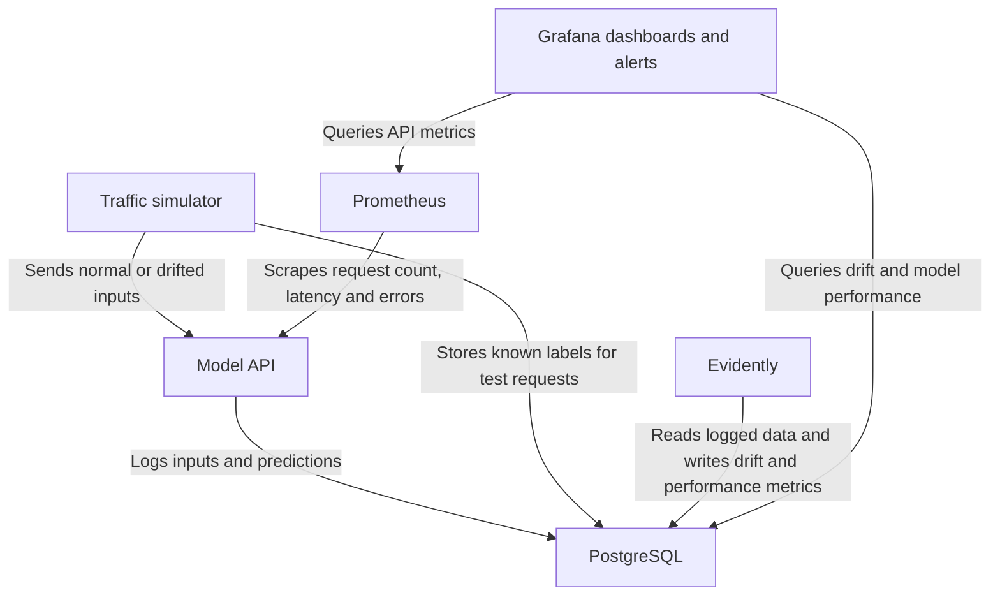

# insy684-mlops-project

## Model API (Dario)

Loads the registered digits model, serves `POST /predict`, saves predictions to
PostgreSQL, and exposes `/metrics`. See [setup](docs/model-api.md).

## Planned Architecture

## Planned Monitoring

## Team Responsibilities

| Team member | Feature branch | Responsibilities |
| --- | --- | --- |
| Logan Jiang | `feature/mlflow-tracking` | Build the training pipeline with Prefect, track experiments in MLflow, and register the selected model. Maintain CI tests and automate Docker image publishing with GitHub Actions. |
| Dario Guo | `feature/model-api` | Build the FastAPI service that loads the registered model and returns predictions. Log predictions to PostgreSQL, expose API metrics, and test the API and database together. |
| Antonin Laferrière-Mailfait | `feature/prediction-frontend` | Build the web interface where users enter data and see predictions from the API. Set up Docker Compose so the team can run the application locally with one command. |
| Asad Nadeem | `feature/traffic-simulator` | Simulate normal traffic and changes in input data. Use Evidently to measure data drift and model performance, and build Grafana dashboards and alerts for model and API monitoring. |
