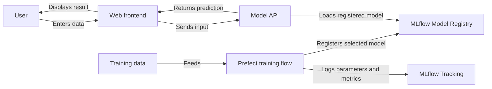
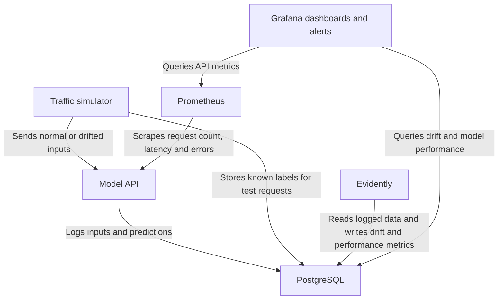

# insy684-mlops-project

## Model API (Dario)

The API loads a version of `digits-decision-tree` from MLflow, serves
`POST /predict`, saves predictions to PostgreSQL, and exposes Prometheus
metrics at `/metrics`. See [API setup and integration contract](docs/model-api.md)
for input format, database columns, Docker instructions, and tests.

`compose.api-test.yml` is a disposable API acceptance stack. It does not replace
the team's final Compose stack, training flow, frontend, or monitoring services.

## Planned Architecture

## Planned Monitoring

